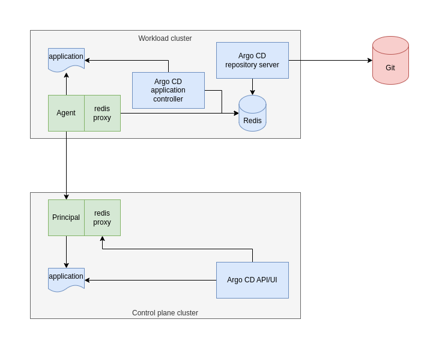

# Integration with Argo CD

!!! info "Deprecated Integration Pattern"
    A previously documented integration pattern (Centralized Resource Sharing) is no longer supported. This pattern centralized the repository-server and redis-server components on the control plane cluster. Only the fully autonomous integration pattern described in this document is currently supported.

## Overview

The *argocd-agent* is designed to complement, not replace, Argo CD by extending its capabilities to multi-cluster environments. It integrates with Argo CD using a fully autonomous pattern where each workload cluster runs the minimum required set of Argo CD components.

This integration enables centralized GitOps management while distributing the actual workload execution across multiple Kubernetes clusters. The agent acts as a bridge between your central control plane (where configuration and observability are managed) and your workload clusters (where applications are deployed and managed).

### Diagram Legend

In the diagrams throughout this document:

* **Light green boxes** represent *argocd-agent* components
* **Light blue boxes** represent Argo CD components  
* **Light red boxes** represent external systems and components

Components with dotted outlines indicate their deployment location depends on the selected [operational mode](./agent-modes.md) of the agent.

## Integration Pattern

### Fully Autonomous Workload Clusters

This integration pattern deploys the minimum required set of Argo CD components on each workload cluster, creating fully autonomous GitOps environments. Depending on the [operational mode](./agent-modes.md) (managed or autonomous), each workload cluster runs at minimum the *application-controller*, *repo-server*, and *redis* cache. Each workload cluster operates as an independent Argo CD instance while maintaining centralized configuration management and observability through the control plane.

This architecture enables workload clusters to perform all GitOps operations locally, including Git repository access, manifest rendering, and state management. The control plane cluster serves primarily as a configuration hub and observability aggregation point.

Workload clusters continue functioning independently during control plane outages, with only configuration updates and observability affected. When combined with [autonomous mode](../user-guide/autonomous-agent/index.md), clusters maintain full GitOps capabilities even during extended control plane unavailability. Each workload cluster scales its Argo CD components independently based on local requirements, and issues with one cluster's components don't affect other clusters in the environment.

## Implementation Considerations

When implementing this integration pattern:

* Ensure workload clusters have adequate resources for the required Argo CD components (*application-controller*, *repo-server*, and *redis* cache), typically requiring an additional 1-2 CPU cores and 2-4GB RAM
* Plan for Git repository access from all workload clusters, including necessary network policies and credentials
* Implement monitoring and alerting for distributed Argo CD components
* Consider using [autonomous mode](../user-guide/autonomous-agent/index.md) to maximize resilience during control plane outages